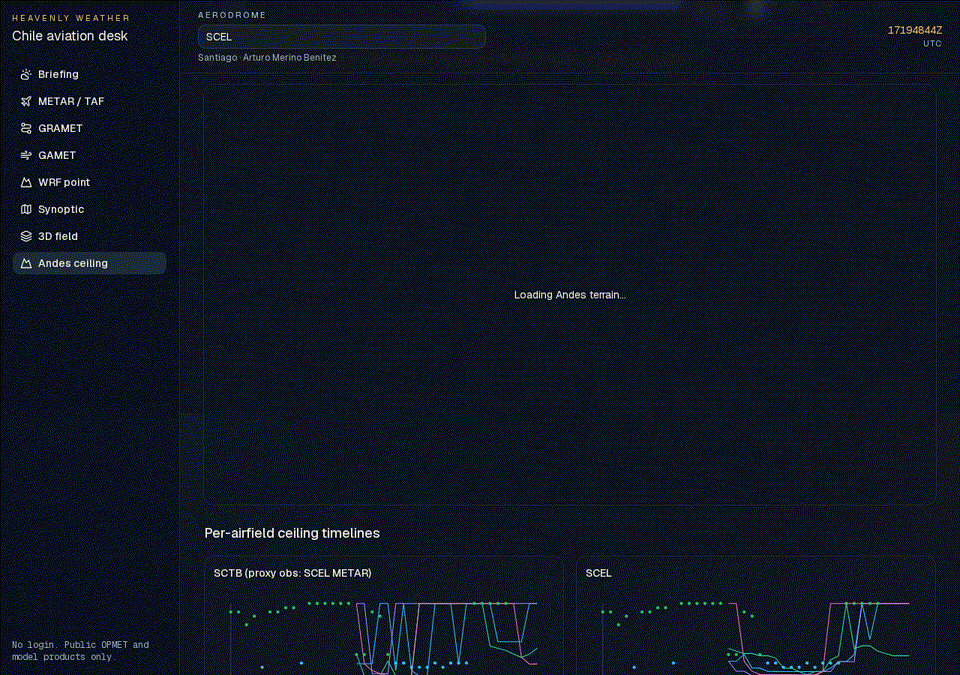
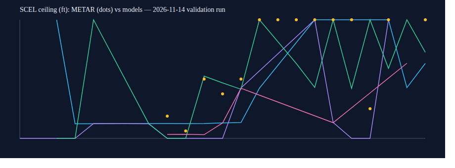

# Heavenly Weather

Chile-first aviation briefing desk for METAR, TAF, GRAMET, GAMET, MeteoChile WRF point forecasts, synoptic charts, and a Cesium 3D weather field. **Step 1** adds an Aguacero-style **Andes ceiling viewer** centred on **SCTB** at `/andes`. Public hostname: [weather.heavenly.cl](https://weather.heavenly.cl). There is **no user login**. Licensed under MIT (Heavenly Tech / Pablo Andalaft).

## Andes ceiling viewer (`/andes`)

| Feature | Description |
| --- | --- |
| Domain | 32.1–34.8°S, 71.8–70.0°W |
| Models | GFS, ECMWF IFS 0.25°, ICON, GEM (Open-Meteo); unavailable models show a warning |
| Headline | Ceiling **ft AGL** over terrain, FAA flight-category colours, mountain-obscuration tint |
| Controls | Linked altitude (**ft MSL** ↔ **hPa**), valid-time slider, model picker |
| Grid | Default **27×18** (~0.1°), batched Open-Meteo multi-point with server cache (`ANDES_GRID_*`, `OPEN_METEO_BATCH_*`) |
| Timelines | SCTB, SCEL, SCVH, SCPD — each model vs METAR (proxy METAR labelled with distance) |
| Generated products | Model METAR/TAF stamped **MODEL OUTPUT — NOT OFFICIAL**, logged to JSONL |

### Ceiling derivation

Documented in `src/lib/andes/ceiling.ts`. Summary:

1. Use Open-Meteo `convective_cloud_base` / `cloud_base` when present (ICON).
2. Otherwise scan pressure levels from the surface upward; **≥ 62.5 %** layer cloud cover (BKN/OVC proxy) or RH ≥ 87 % sets the base MSL via `geopotential_height_*hPa`.
3. Convert to **ft AGL** using model grid elevation; flag **obscuration** when base MSL ≤ terrain.
4. Map FAA categories: VFR > 3000 ft; MVFR 1000–3000; IFR 500–<1000; LIFR < 500.

### Screenshots

Captured with Playwright on the running app (**no Cesium Ion token** — ellipsoid terrain + OpenStreetMap). Regenerate: `npm run build && CAPTURE_BASE_URL=http://127.0.0.1:4310 npm run capture:andes`.

| Viewer | Asset |
| --- | --- |
| Ceiling map |  |
| Altitude slice |  |
| SCEL timeline section |  |
| Time slider |  |

### How it was validated

Repeatable pipeline: `npm run validate:ceilings` → writes `docs/validation/sceil-YYYY-MM-DD/` (AWC METAR JSON, Open-Meteo `past_days=3` model JSON, `summary.json`, chart).

**Data window:** SCEL METARs from AWC (`hours=72`, 2026-11-14 → 2026-11-17 UTC) plus companion pulls for **SCVM** and **SCPD** (`awc-metars-scvm.json`, `awc-metars-scpd.json`). Models: Open-Meteo forecast API with `past_days=3`, hourly pressure-level cloud/RH/height, run through `ceilingFromHourly` at SCEL elevation.

**Category hit rate & MAE (ceilings &lt; 10 000 ft):** see `docs/validation/sceil-2026-11-17/stats-table.md`

| Model | Category hit rate | Mean \|ceil err\| (ft) | N |
| --- | ---: | ---: | ---: |
| GFS | 66.7% (8/12) | 1777 | 5 |
| ECMWF IFS 0.25° | 30.0% (3/10) | 1934 | 6 |
| DWD ICON | 69.2% (9/13) | 725 | 5 |
| GEM | 33.3% (2/6) | 1559 | 5 |

**Sample 3-hourly rows** (full table in `summary.json`):

| Valid (UTC) | METAR ft | Cat | GFS ft | ECMWF ft | ICON ft | GEM ft |
| --- | ---: | --- | ---: | ---: | ---: | ---: |
| 2026-11-15 03:00 | 1500 | MVFR | 997 | 0 | 0 | 266 |
| 2026-11-15 06:00 | 500 | IFR | 988 | 0 | 0 | 276 |
| 2026-11-15 12:00 | 3000 | MVFR | 1040 | 0 | 3740 | 1037 |
| 2026-11-15 15:00 | 4000 | VFR | 1066 | 3399 | 3314 | 3379 |



**Where it fails (honest):**

- ECMWF layers often collapse to **0 ft AGL** when low-level cloud cover hits the BKN threshold at 1000 hPa but METAR reports a higher scattered layer — category scores suffer (30% hit rate).
- GFS/GEM MAE ~1.5–1.8k ft when both ceilings are below 10k ft — the pressure-level proxy misplaces the base.
- ICON matches category more often (69%) but can overshoot (e.g. 24k ft when METAR is clear at 15k).
- `past_days` model hours are **not** a strict archived forecast run; they are Open-Meteo’s stored hourly states — good for regression, not for proving forecaster skill.
- Clear-sky METAR (`ceil` null / very high) vs model “unlimited” is only partially aligned in scoring.

**Honest gaps:** Open-Meteo does not expose ECMWF/GFS `cloud_base`; pressure-level cover is a proxy. Use for situational awareness, not minima planning.

DGAC product research: [docs/dgac-chile-products.md](docs/dgac-chile-products.md).

## Run locally

```bash
npm install
cp .env.example .env.local   # optional MeteoChile token
npm run dev
npm test                     # fixture-only unit tests (no network)
```

The dev server binds `0.0.0.0:43123`. Open http://127.0.0.1:43123.

## Production (weather.heavenly.cl)

Same nginx-proxy stack as [flight.heavenly.cl](https://flight.heavenly.cl) and [mora.oficinaslascondes.cl](https://mora.oficinaslascondes.cl). Internal listen port is **4310**. The compose file sets `VIRTUAL_HOST`, `LETSENCRYPT_HOST`, and `VIRTUAL_PORT` and joins the external `proxy_network`.

On a machine that can `ssh heavenly`:

```bash
./deploy.sh
```

That clones or updates `/opt/stacks/app-heavenly-weather` and runs `docker compose up -d --build`.

Manual equivalent on the VPS:

```bash
mkdir -p /opt/stacks
git clone https://github.com/heavenly-tech/weather.git /opt/stacks/app-heavenly-weather
cd /opt/stacks/app-heavenly-weather
docker compose up -d --build
```

Optional environment next to compose (MeteoChile WRF-DMC). Without these, the WRF page uses live Open-Meteo GFS:

| Variable | Purpose |
| --- | --- |
| `METEOCHILE_USER` | Email registered with MeteoChile Servicios Climáticos |
| `METEOCHILE_TOKEN` | Personal token for WRF-DMC `getDatosModelo` |

Health: `http://127.0.0.1:4310/api/health` inside the container.

## What is live vs mocked

| Product | Live source | Fallback |
| --- | --- |
| METAR / TAF | NOAA Aviation Weather Center | Clearly marked mock observation/forecast |
| GRAMET | Derived from Open-Meteo GFS pressure levels along the route | Mock sounding |
| GAMET | Derived GAMET-style bulletin from GFS + AWC SIGMETs (official DGAC GAMET is OPMET-only) | Mock bulletin |
| Point forecast | MeteoChile WRF-DMC when a token is set | Open-Meteo GFS, then mock |
| Synoptic | NOAA WPC South America charts, proxied | Error state with a link to NOAA |
| 3D field | Live METARs + GFS column on a Cesium globe (OpenStreetMap tiles) | Mock stations |

## Notes

- Chile-first ICAO list (SCEL, SCFA, SCTE, SCCI, …) plus Lima and Ezeiza for international GRAMETs.
- Every product card shows **Live / Fallback / Derived / Mock**.
- 3D visualization is Cesium only (no Three.js).
- Not a certified flight-briefing source. Cross-check OPMET before you fly.
