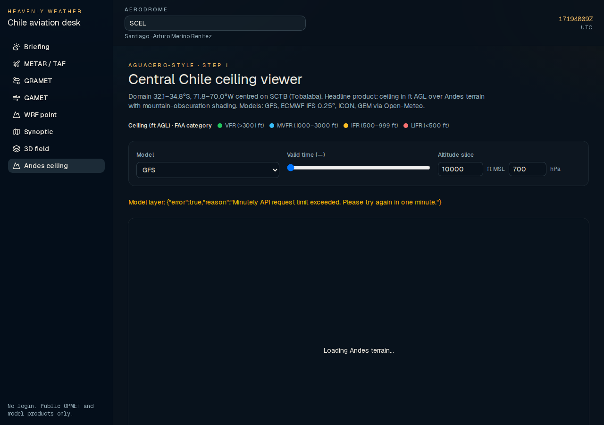
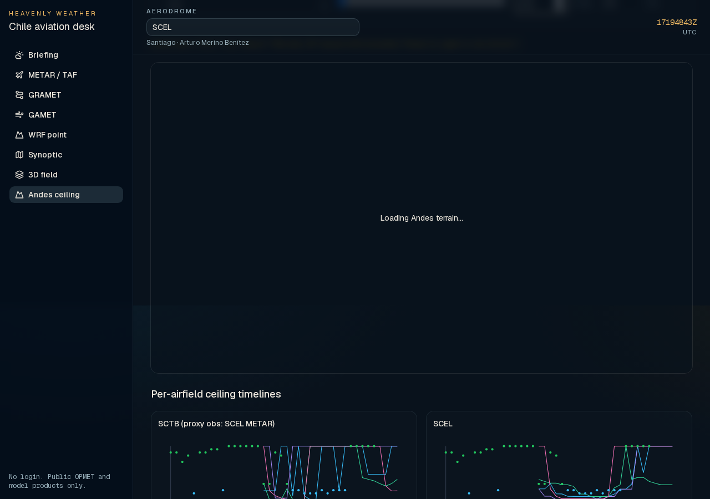
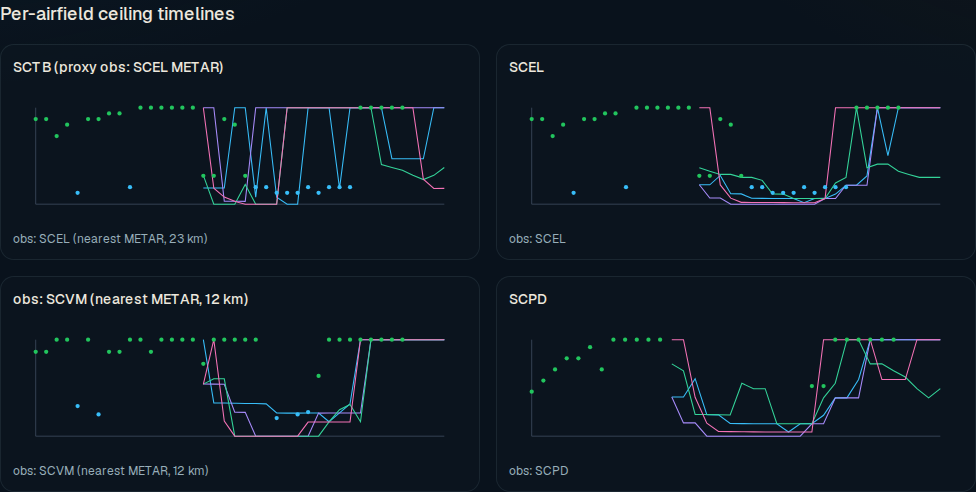
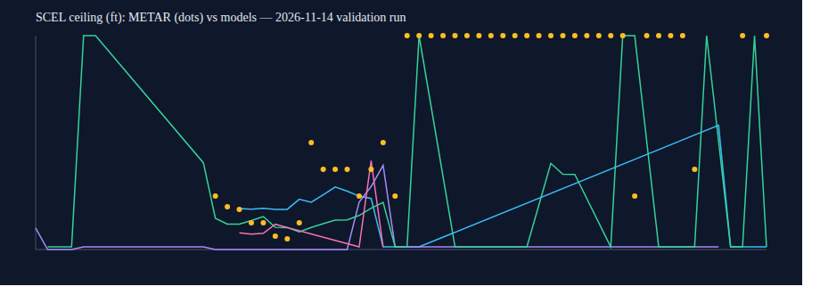

# Heavenly Weather

Chile-first aviation briefing desk for METAR, TAF, GRAMET, GAMET, MeteoChile WRF point forecasts, synoptic charts, and a Cesium 3D weather field. **Step 1** adds an Aguacero-style **Andes ceiling viewer** centred on **SCTB** at `/andes`. Public hostname: [weather.heavenly.cl](https://weather.heavenly.cl). There is **no user login**. Licensed under MIT (Heavenly Tech / Pablo Andalaft).

## Andes ceiling viewer (`/andes`)

| Feature | Description |
| --- | --- |
| Domain | 32.1–34.8°S, 71.8–70.0°W |
| Models | GFS, ECMWF IFS 0.25°, ICON, GEM (Open-Meteo); unavailable models show a warning |
| Headline | Ceiling **ft AGL** over terrain, FAA flight-category colours, mountain-obscuration tint |
| Controls | Linked altitude (**ft MSL** ↔ **hPa**), valid-time slider, model picker |
| Grid | Default **9×6** (~0.25°), batched Open-Meteo multi-point with server cache (`ANDES_GRID_*`, `OPEN_METEO_BATCH_*`) |
| Timelines | SCTB, SCEL, SCVH, SCPD — each model vs METAR (proxy METAR labelled with distance) |
| Generated products | Model METAR/TAF stamped **MODEL OUTPUT — NOT OFFICIAL**, logged to JSONL |

### Ceiling derivation

Documented in `src/lib/andes/ceiling.ts`. Summary:

1. Skip pressure levels **above** `surface_pressure` or with geopotential height **≤ terrain** (underground artefacts in the Andes).
2. **Interpolate** the BKN (62.5 %) crossing in height between adjacent layers (linear in cover vs geopotential height); prefer `cloud_cover_low/mid/high` where present.
3. ICON **`convective_cloud_base`** is **metres AMSL** (ignore ≤ 0 or ≤ −500); never add terrain; take the **lower** MSL base vs stratiform scan (does not override).
4. Convert to **ft AGL**; flag **obscuration** when base MSL ≤ terrain; categories use ceiling **and** model visibility when present.

### Screenshots

Captured with Playwright on the running app (**no Cesium Ion token** — ellipsoid terrain + OpenStreetMap). Regenerate: `npm run build && CAPTURE_BASE_URL=http://127.0.0.1:4310 npm run capture:andes`.

| Viewer | Asset |
| --- | --- |
| Ceiling map |  |
| Altitude slice |  |
| SCEL timeline section |  |
| Time slider |  |

### How it was validated

Repeatable pipeline: `npm run validate:ceilings` → writes `docs/validation/scel-YYYY-MM-DD/` (AWC METAR JSON, Open-Meteo `past_days=3` model JSON, `summary.json`, chart).

**Data window:** SCEL METARs from AWC (`hours=72`, 2026-11-14 → 2026-11-17 UTC) plus companion pulls for **SCVM** and **SCPD** (`awc-metars-scvm.json`, `awc-metars-scpd.json`). Models: Open-Meteo forecast API with `past_days=3`, hourly pressure-level cloud/RH/height/**surface_pressure**, run through `ceilingFromHourly` at SCEL elevation (underground levels skipped).

Hourly UTC pairing over **all** METAR hours in the window; contingency table (MVFR/IFR/LIFR events) reports POD, FAR, CSI. MAE **N** is the count of paired finite ceilings (&lt; 10 kft both sides).

**Stats (2026-11-17 run):** `docs/validation/scel-2026-11-17/stats-table.md`

| Model | Cat agree | POD | FAR | CSI | MAE ft | N |
| --- | ---: | ---: | ---: | ---: | ---: | ---: |
| GFS | 70.6% (36/51) | 0.75 | 0.40 | 0.50 | 1116 | 14 |
| ECMWF IFS 0.25° | 64.7% (33/51) | 0.81 | 0.28 | 0.62 | 1466 | 14 |
| DWD ICON | 47.1% (24/51) | 0.94 | 0.56 | 0.43 | 1274 | 17 |
| GEM | 68.6% (35/51) | 0.31 | 0.17 | 0.29 | 1181 | 7 |

**Sample 3-hourly rows** (full table in `summary.json`):

| Valid (UTC) | METAR ft | Cat | GFS ft | ECMWF ft | ICON ft | GEM ft |
| --- | ---: | --- | ---: | ---: | ---: | ---: |
| 2026-11-15 03:00 | 1500 | MVFR | 997 | 1007 | 255 | 266 |
| 2026-11-15 06:00 | 500 | IFR | 987 | 1026 | 265 | 276 |
| 2026-11-15 09:00 | 4000 | VFR | 997 | 987 | 4199 | 249 |
| 2026-11-15 12:00 | 3000 | MVFR | 1040 | 1056 | 3740 | 1037 |



**Where it fails (honest):**

- ICON category agreement is weakest (24/51) despite high POD — FAR 0.56 on low-ceiling events.
- MAE remains ~1.1–1.5k ft — pressure-level cover is still a proxy, not a cloud base field.
- GEM has low POD (0.31) on MVFR/IFR/LIFR events with modest FAR.
- `past_days` hours are Open-Meteo archived states, not a formal archived forecast run.
- Clear-sky METAR (no BKN/OVC base) vs model “unlimited” is only partially aligned in scoring.

**Honest gaps:** No official `cloud_base` from ECMWF/GFS on Open-Meteo; ceilings use pressure-level cover. Underground 1000/975 hPa layers are ignored via `surface_pressure` and terrain height (see `ceiling.ts`).

DGAC product research: [docs/dgac-chile-products.md](docs/dgac-chile-products.md).

## Run locally

```bash
npm install
cp .env.example .env.local   # optional MeteoChile token
npm run dev
npm test                     # fixture-only unit tests (no network)
```

The dev server binds `0.0.0.0:43123`. Open http://127.0.0.1:43123.

## Production (weather.heavenly.cl)

Same nginx-proxy stack as [flight.heavenly.cl](https://flight.heavenly.cl) and [mora.oficinaslascondes.cl](https://mora.oficinaslascondes.cl). Internal listen port is **4310**. The compose file sets `VIRTUAL_HOST`, `LETSENCRYPT_HOST`, and `VIRTUAL_PORT` and joins the external `proxy_network`.

On a machine that can `ssh heavenly`:

```bash
./deploy.sh
```

That clones or updates `/opt/stacks/app-heavenly-weather` and runs `docker compose up -d --build`.

Manual equivalent on the VPS:

```bash
mkdir -p /opt/stacks
git clone https://github.com/heavenly-tech/weather.git /opt/stacks/app-heavenly-weather
cd /opt/stacks/app-heavenly-weather
docker compose up -d --build
```

Optional environment next to compose (MeteoChile WRF-DMC). Without these, the WRF page uses live Open-Meteo GFS:

| Variable | Purpose |
| --- | --- |
| `METEOCHILE_USER` | Email registered with MeteoChile Servicios Climáticos |
| `METEOCHILE_TOKEN` | Personal token for WRF-DMC `getDatosModelo` |

Health: `http://127.0.0.1:4310/api/health` inside the container.

## What is live vs mocked

| Product | Live source | Fallback |
| --- | --- |
| METAR / TAF | NOAA Aviation Weather Center | Clearly marked mock observation/forecast |
| GRAMET | Derived from Open-Meteo GFS pressure levels along the route | Mock sounding |
| GAMET | Derived GAMET-style bulletin from GFS + AWC SIGMETs (official DGAC GAMET is OPMET-only) | Mock bulletin |
| Point forecast | MeteoChile WRF-DMC when a token is set | Open-Meteo GFS, then mock |
| Synoptic | NOAA WPC South America charts, proxied | Error state with a link to NOAA |
| 3D field | Live METARs + GFS column on a Cesium globe (OpenStreetMap tiles) | Mock stations |

## Notes

- Chile-first ICAO list (SCEL, SCFA, SCTE, SCCI, …) plus Lima and Ezeiza for international GRAMETs.
- Every product card shows **Live / Fallback / Derived / Mock**.
- 3D visualization is Cesium only (no Three.js).
- Not a certified flight-briefing source. Cross-check OPMET before you fly.
