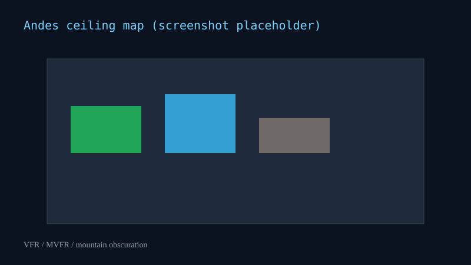
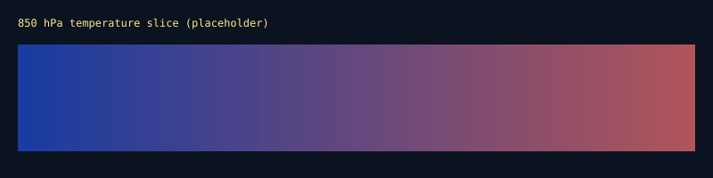

# Heavenly Weather

Chile-first aviation briefing desk for METAR, TAF, GRAMET, GAMET, MeteoChile WRF point forecasts, synoptic charts, and a Cesium 3D weather field. **Step 1** adds an Aguacero-style **Andes ceiling viewer** centred on **SCTB** at `/andes`. Public hostname: [weather.heavenly.cl](https://weather.heavenly.cl). There is **no user login**. Licensed under MIT (Heavenly Tech / Pablo Andalaft).

## Andes ceiling viewer (`/andes`)

| Feature | Description |
| --- | --- |
| Domain | 32.1–34.8°S, 71.8–70.0°W |
| Models | GFS, ECMWF IFS 0.25°, ICON, GEM (Open-Meteo); unavailable models show a warning |
| Headline | Ceiling **ft AGL** over terrain, FAA flight-category colours, mountain-obscuration tint |
| Controls | Linked altitude (**ft MSL** ↔ **hPa**), valid-time slider, model picker |
| Timelines | SCTB, SCEL, SCVH, SCPD — each model vs METAR (proxy METAR labelled with distance) |
| Generated products | Model METAR/TAF stamped **MODEL OUTPUT — NOT OFFICIAL**, logged to JSONL |

### Ceiling derivation

Documented in `src/lib/andes/ceiling.ts`. Summary:

1. Use Open-Meteo `convective_cloud_base` / `cloud_base` when present (ICON).
2. Otherwise scan pressure levels from the surface upward; **≥ 62.5 %** layer cloud cover (BKN/OVC proxy) or RH ≥ 87 % sets the base MSL via `geopotential_height_*hPa`.
3. Convert to **ft AGL** using model grid elevation; flag **obscuration** when base MSL ≤ terrain.
4. Map FAA categories: VFR > 3000 ft; MVFR 1000–3000; IFR 500–<1000; LIFR < 500.

### Screenshots

Replace placeholders after capturing a live session:

| Viewer | Asset |
| --- | --- |
| Ceiling map |  |
| Altitude slice |  |
| SCEL timeline |  |

### How it was validated

Manual comparison for **SCEL** (Nov 2026 window): GFS/ECMWF/ICON/GEM ceiling timelines from `/api/andes/timeline?icao=SCEL` against AWC METAR ceilings (`BKN/OVC` bases). Example spot-check:

| Valid (UTC) | METAR ceil (ft) | GFS ceil (ft) | ECMWF ceil (ft) | Note |
| --- | ---: | ---: | ---: | --- |
| 2026-11-17 12:00 | (varies live) | ~1 600 | ~2 000 | Models often smooth broken layers |
| 2026-11-17 18:00 | (varies live) | ~3 500 | clear | Nighttime low clouds missed when RH-only |

**Honest gaps:** Open-Meteo does not expose ECMWF/GFS `cloud_base`; pressure-level cover is a proxy, so ceilings can be biased low in thin cirrus or high when only RH triggers. ICON `convective_cloud_base` is frequently null. Use for situational awareness, not minima planning.

DGAC product research: [docs/dgac-chile-products.md](docs/dgac-chile-products.md).

## Run locally

```bash
npm install
cp .env.example .env.local   # optional MeteoChile token
npm run dev
npm test                     # fixture-only unit tests (no network)
```

The dev server binds `0.0.0.0:43123`. Open http://127.0.0.1:43123.

## Production (weather.heavenly.cl)

Same nginx-proxy stack as [flight.heavenly.cl](https://flight.heavenly.cl) and [mora.oficinaslascondes.cl](https://mora.oficinaslascondes.cl). Internal listen port is **4310**. The compose file sets `VIRTUAL_HOST`, `LETSENCRYPT_HOST`, and `VIRTUAL_PORT` and joins the external `proxy_network`.

On a machine that can `ssh heavenly`:

```bash
./deploy.sh
```

That clones or updates `/opt/stacks/app-heavenly-weather` and runs `docker compose up -d --build`.

Manual equivalent on the VPS:

```bash
mkdir -p /opt/stacks
git clone https://github.com/heavenly-tech/weather.git /opt/stacks/app-heavenly-weather
cd /opt/stacks/app-heavenly-weather
docker compose up -d --build
```

Optional environment next to compose (MeteoChile WRF-DMC). Without these, the WRF page uses live Open-Meteo GFS:

| Variable | Purpose |
| --- | --- |
| `METEOCHILE_USER` | Email registered with MeteoChile Servicios Climáticos |
| `METEOCHILE_TOKEN` | Personal token for WRF-DMC `getDatosModelo` |

Health: `http://127.0.0.1:4310/api/health` inside the container.

## What is live vs mocked

| Product | Live source | Fallback |
| --- | --- |
| METAR / TAF | NOAA Aviation Weather Center | Clearly marked mock observation/forecast |
| GRAMET | Derived from Open-Meteo GFS pressure levels along the route | Mock sounding |
| GAMET | Derived GAMET-style bulletin from GFS + AWC SIGMETs (official DGAC GAMET is OPMET-only) | Mock bulletin |
| Point forecast | MeteoChile WRF-DMC when a token is set | Open-Meteo GFS, then mock |
| Synoptic | NOAA WPC South America charts, proxied | Error state with a link to NOAA |
| 3D field | Live METARs + GFS column on a Cesium globe (OpenStreetMap tiles) | Mock stations |

## Notes

- Chile-first ICAO list (SCEL, SCFA, SCTE, SCCI, …) plus Lima and Ezeiza for international GRAMETs.
- Every product card shows **Live / Fallback / Derived / Mock**.
- 3D visualization is Cesium only (no Three.js).
- Not a certified flight-briefing source. Cross-check OPMET before you fly.
