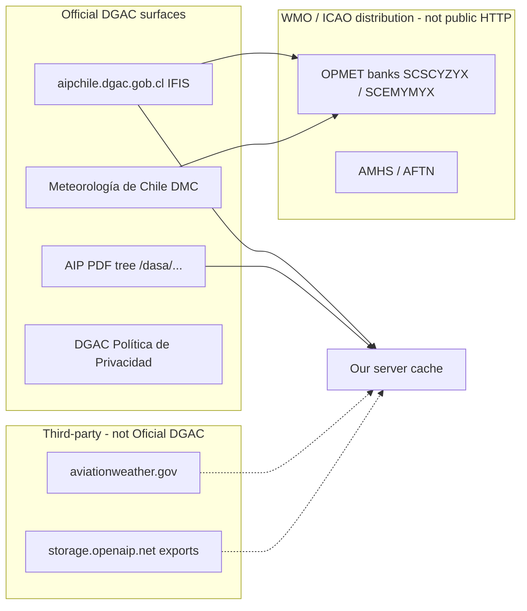

# DGAC / AIP Chile — official data layer research (PR 1)

**Repo:** heavenly-tech/weather  
**Verified:** 2026-11-18 (UTC) against live hosts  
**Scope:** Identify machine-accessible sources for official METAR/TAF/GAMET, SIGMET/AIRMET, NOTAM, and AIP airspace (CTR/TMA/ATZ, P/R/D, ENR 5.x) for Chilean aerodromes and Santiago FIR (**SCEZ**). Propose implementation for follow-on PRs 2–5.  
**Credentials:** none (anonymous HTTP only).

This document supersedes the high-level rows in [../dgac-chile-products.md](../dgac-chile-products.md) for *official DGAC* sourcing. That file remains valid for **third-party** feeds (AWC, Open-Meteo) already used for model-adjacent products.

---

## Executive summary

| Product | Official DGAC / Chile source on the public web? | Machine-readable without HTML parse? | Recommended official path |
| --- | --- | --- | --- |
| METAR / SPECI | **Yes** — IFIS HTML | **No** stable JSON/IWXXM URL found | Server fetch + parse `aipchile.dgac.gob.cl` |
| TAF | **Yes** — IFIS HTML | **No** public IWXXM HTTP (policy: IWXXM to OPMET only) | Same as METAR |
| GAMET | **No** public HTTP | OPMET / AFTN / AMHS (AIP GEN 3.5) | Show unavailable; optional derived bulletin stays **model** |
| AIRMET | **No** IFIS page (`/airmet` → 404) | OPMET | Same as GAMET; do not label AWC as DGAC |
| SIGMET (SCEZ) | **Yes** — IFIS HTML + map JS | Polygons embedded in HTML/JS when active | Parse IFIS; cross-check receipt time vs AWC |
| NOTAM | **Yes** — IFIS HTML | **No** JSON API | Parse IFIS; validity from `B)`/`C)` fields |
| AIP airspace | **Yes** — PDF tree under `/dasa/...` | **No** DGAC AIXM/GeoJSON | PDF/AIRAC ingest or **third-party** OpenAIP (not “Oficial DGAC”) |

**Bottom line:** DGAC publishes **authoritative** METAR, TAF, SIGMET, NOTAM, and AIP text/charts on **IFIS** ([https://aipchile.dgac.gob.cl](https://aipchile.dgac.gob.cl)), but there is **no documented, stable REST API**. PR 2–5 should use **server-side fetching**, **short TTL caches**, **recorded HTML fixtures**, and an explicit **“Oficial DGAC”** badge separate from model and third-party layers.

---

## Systems map



| Host | Role | Auth |
| --- | --- | --- |
| [https://aipchile.dgac.gob.cl](https://aipchile.dgac.gob.cl) | **IFIS** — METAR, TAF, NOTAM, SIGMET, AIP index, aerodrome search | Optional login for flight-plan features; products above are readable anonymously |
| [https://aipchile.dgac.gob.cl/dasa/aip_chile_con_contenido/](https://aipchile.dgac.gob.cl/dasa/aip_chile_con_contenido/) | Static AIP Chile PDFs (VOL I ENR/AD, VOL II maps) | None |
| [https://servicios.dgac.gob.cl/dgac_backend/api/v1/...](https://servicios.dgac.gob.cl/dgac_backend/api/v1/) | Document downloads (policy PDFs, internal docs) | None for public document UUIDs; **not** a weather API |
| [https://www.meteochile.gob.cl](https://www.meteochile.gob.cl) | DMC climatology / registered JSON services | Token for some JSON; **not** OPMET METAR/TAF for briefing |
| [https://climatologia.meteochile.gob.cl](https://climatologia.meteochile.gob.cl) | Historical / station JSON catalogues | Registration for many endpoints |

IFIS is branded DGAC but the footer credits **VIA56 S.A.** (operator). Treat IFIS as the **operational publication channel** for DGAC AIS/OPMET products on the web.

---

## robots.txt and crawling posture

**URL:** [https://aipchile.dgac.gob.cl/robots.txt](https://aipchile.dgac.gob.cl/robots.txt) (fetched 2026-11-18)

```
#User-agent: *
#Disallow:
```

The file is entirely commented out → **no `Disallow` rules are active**. This does **not** grant bulk-scraping rights; combine with DGAC privacy / security policy (below) and conservative rate limits.

IFIS HTML meta robots: `index, follow` on product pages.

---

## Terms, privacy, and reuse

| Document | URL | Relevance |
| --- | --- | --- |
| Política de privacidad (DGAC) | [PDF](https://www.dgac.gob.cl/rest-portalweb/jcr/repository/collaboration/sites%20content/live/dgac/web%20contents/site%20artifacts/barrainferiorprensa/documents/PoliticaPrivacidad.pdf) | Lists **https://aipchile.dgac.gob.cl** in the annex of covered sites (Enmienda 3, 05-NOV-2026). Privacy focuses on **personal data** in forms; aviation bulletins are operational aeronautical information. |
| IFIS footer | Each IFIS page | Links to the same Política de privacidad; help: **ifis@dgac.gob.cl**. Copyright **VIA56 S.A. 2010** / “Todos los derechos reservados”. **No explicit open-data / API licence** on IFIS. |
| AWC Data API | [https://aviationweather.gov/data/api/](https://aviationweather.gov/data/api/) | Usable for **WMO circuit copies** of METAR/TAF/SIGMET; **not** a DGAC authority. Rate limit **100 req/min**; custom User-Agent required. |

**Quoted privacy excerpt (personal data; Spanish):**

> “Visitante: Aquella persona que accede libremente a la información disponible en www.dgac.gob.cl … sin necesidad de registrarse previamente.”  
> — [Política de Privacidad DGAC](https://www.dgac.gob.cl/rest-portalweb/jcr/repository/collaboration/sites%20content/live/dgac/web%20contents/site%20artifacts/barrainferiorprensa/documents/PoliticaPrivacidad.pdf), §III.C.2

**Security / blocking (same PDF, §III.C.9):** DGAC reserves the right to **block suspicious or malicious access** (IP monitoring, CSIRT alignment). **Implication:** use a identifiable User-Agent (`heavenly-weather/…`), low frequency, backoff on errors, and **never** fan out per-client from the browser (server-side only).

**Reuse:** For operational briefing, cite **issue time** and **source URL**. Do not republish full NOTAM/AIP PDF corpora. Aggregated, attributed excerpts for in-app display are the intended use case for this project.

---

## Product reference

### METAR / SPECI

| Field | Value |
| --- | --- |
| **Official URL(s)** | `GET /metar?metodo=aerodromo&designador={ICAO}&boton=Consultar` — [example SCTB](https://aipchile.dgac.gob.cl/metar?metodo=aerodromo&designador=SCTB&boton=Consultar) |
| | `GET /metar/{ICAO}` — [example](https://aipchile.dgac.gob.cl/metar/SCTB) |
| | Filter form: `metar_filters[designador]`, `hora`, `categoria` (METAR/SPECI), date range |
| **Format** | HTML; raw report in `div.codificacion` (WMO METAR line) |
| **Cadence** | Hourly METAR (+ SPECI as issued); list shows recent hours per aerodrome |
| **Auth** | None for read |
| **Stability** | Moderate — Symfony-style paths stable for years; HTML/CSS may change |

**Station spot-check (2026-11-18 ~13:00Z):**

| ICAO | METAR on IFIS | Notes |
| --- | --- | --- |
| SCTB | Yes | |
| SCEL | Yes | |
| SCVH | Yes | VFR aerodrome; METAR present |
| SCIL | Verify operationally | Use IFIS search; may be sparse |
| SCIC | Yes | Sample matched AWC |
| SCTL | Verify operationally | |

**Only JSON helper found:** `GET /aerodromo/search?term={q}` → JSON array `[{ "label", "designador" }]`.  
Example: `https://aipchile.dgac.gob.cl/aerodromo/search?term=SCTB`

**Sanitized sample (SCTB, from IFIS HTML):**

```
METAR SCTB 181300Z 24003KT 9999 SCT120 17/11 Q1016
```

**Official fallback (third-party, WMO circuit):**  
`https://aviationweather.gov/api/data/metar?ids={ICAO}&format=json` — same bulletin family, **not** labelled “Oficial DGAC”. Useful for parity tests and when IFIS is down.

**Recommended fetch:** Server-side `GET` with `Accept-Language: es`, parse latest `div.codificacion` + heading time (`METAR del DD-MM-YYYY a las HH:MM UTC`). **TTL cache: 5 min** (METAR) / **2 min** after detected SPECI. **Rate: ≤ 1 req/min per ICAO**, ≤ 6 req/min global to IFIS.

---

### TAF

| Field | Value |
| --- | --- |
| **Official URL(s)** | `GET /taf?designador={ICAO}` — [SCTB](https://aipchile.dgac.gob.cl/taf?designador=SCTB), [SCEL](https://aipchile.dgac.gob.cl/taf?designador=SCEL) |
| **Format** | HTML; TAF line in `div.taf_h3.codificacion` |
| **Cadence** | Per AIP / DAP: TAF AMD/COR/CNL; SCEL issues shown with station clock in header |
| **Auth** | None for read |
| **IWXXM** | AIP states TAF also diffused in **IWXXM GML** to OPMET — **no public IWXXM endpoint** on IFIS |

**Sanitized samples:**

```
TAF SCTB 181100Z 1812/1824 VRB02KT 9999 SCT030 BKN050 TX25/1819Z TN16/1812Z BECMG 1816/1818 20010KT CAVOK
TAF SCEL 181000Z 1812/1912 14004KT 9999 SCT030 TX26/1819Z TN12/1910Z BECMG 1813/1815 CAVOK ...
```

**SCVH:** IFIS returns **“No existe TAF para ese designador”** (expected for many VFR fields).

**AWC fallback:** `https://aviationweather.gov/api/data/taf?ids={ICAO}&format=json` — on 2026-11-18 only **SCEL** returned JSON; **SCTB** returned `[]` while IFIS had a TAF → **do not rely on AWC alone for Chile official parity**.

**Recommended fetch:** Parse TAF line + header issue time (`TAF del DD/MM/YYYY a las HH:MM UTC`). **TTL: min(30 min, time-to-next-AIP-scheduled-issue)**; shorten to **5 min** when `TAF AMD` / `TAF COR` detected. Store `validFrom`/`validTo` from bulletin body for staleness UI.

---

### GAMET

| Field | Value |
| --- | --- |
| **Official public HTTP** | **None found** on IFIS (no GAMET menu item; no API) |
| **Distribution** | AIP **GEN 3.5** / DAP: GAMET-style **area forecasts** via **OPMET**, **VOLMET**, MSS — same family as international exchange |
| **Related** | MeteoChile portal linked from TAF pages for “mayor información” — human portal, not GAMET API |

**Recommendation (PR 2):** Expose `officialGamet: null` with reason `opmet_only`. Keep existing **derived GAMET-style** product clearly labelled **model / not official**.

---

### AIRMET

| Field | Value |
| --- | --- |
| **IFIS** | `GET /airmet` → **404** |
| **Official** | Issued by OVM per DAP 03-09; same OPMET family as SIGMET |
| **AWC** | G-AIRMET is **CONUS-only**; international AIRMET coverage on AWC is limited — **not a Chile official substitute** |

**Recommendation (PR 3):** If AIRMET is required, parse only if DGAC later publishes on IFIS; until then, **omit or show unavailable** under “Oficial DGAC”.

---

### SIGMET / AIRMET (Santiago FIR SCEZ)

| Field | Value |
| --- | --- |
| **List** | [https://aipchile.dgac.gob.cl/sigmet](https://aipchile.dgac.gob.cl/sigmet) — HTML table |
| **Map** | [https://aipchile.dgac.gob.cl/sigmet/map](https://aipchile.dgac.gob.cl/sigmet/map) — OpenLayers 3; `/js/sigmet.js` |
| **Format** | HTML + inline JS: `obsArray` objects `{ label, coords, text }` where `coords` is space-separated `lon,lat` pairs (`EPSG:4326`) |
| **Cadence** | Event-driven; empty `obsArray` when no active SIGMET (verified 2026-11-18) |
| **Auth** | None |

**Parsing notes:** `fullMap(obsArray, volcArray)` in `/js/sigmet.js`. Phenomenon colour keyed by `label` (`TS`, `Turb`, `Ice`, `VA`, …). Popup body in `text` (HTML).

**AWC fallback (third-party):**  
`https://aviationweather.gov/api/data/isigmet?format=json&bbox={west,south,east,north}`  
Returns GeoJSON-like coords + `rawSigmet`; filter `firId === "SCEZ"` if present. **Label as WMO circuit / AWC**, not DGAC.

**Recommended fetch:** Poll IFIS `/sigmet/map` **every 5 min** when desk open, **15 min** background. Parse polygons + validity from SIGMET text in `text`. If IFIS empty and AWC shows SCEZ, prefer **IFIS authoritative** for “Oficial DGAC” (show IFIS empty state).

---

### NOTAM (aerodrome + FIR)

| Field | Value |
| --- | --- |
| **By aerodrome** | `GET /notam?designador={ICAO}` — [SCTB example](https://aipchile.dgac.gob.cl/notam?designador=SCTB) |
| **Filter** | `GET /notam?filter=1&notam_filters[fir]=SCEZ&...` (FIR column includes **SCEZ**) |
| **Format** | HTML table; ICAO NOTAM line in `td.codificacion` (`Q)`, `A)`, `B)`, `C)`, `E)` …) |
| **Cadence** | Continuous; IFIS shows counts e.g. “Notams (30)” for SCEL |
| **Auth** | None for read |

**Sanitized excerpt (SCTB obstacle NOTAM, fields only):**

```
C4735/26 NOTAMN
Q)SCEZ/QOBCE/IV/M/AE/000/999/3347S07055W001
A)SCTB B)2612010300 C)2703012359
E) OBST GRUA 42M A 0.666KM SE AD, CTN ...
```

**Validity filtering:** Parse `B)` start and `C)` end as UTC `YYMMDDhhmm`; drop when `now > C)` or cancelled. Keep `series/id` for deduplication.

**Third-party fallbacks:**

| Source | Chile coverage | Official? |
| --- | --- | --- |
| FAA NOTAM API | US-centric | No |
| ICAO / commercial NOTAM aggregators | Varies; often paywalled | No |

**Recommended fetch:** **TTL 10 min** per `(designador|fir)`; revalidate on user refresh. Cap stored NOTAMs (e.g. 200/FIR). Server-side only.

---

### AIP airspace (CTR/TMA/ATZ, P/R/D, ENR 5.x)

| Field | Value |
| --- | --- |
| **Index** | [AIP VOL I ENR](https://aipchile.dgac.gob.cl/aip/vol1/seccion/enr) |
| **ENR 2 ATS airspace** | PDF e.g. [aENR 2.1-1 … FIR, TMA](https://aipchile.dgac.gob.cl/dasa/aip_chile_con_contenido/ais/2%20ENR%20Parte%202/ENR%202%20Espacio%20Aereo%20ATS/aENR%202.1-1%20al%20ENR%202.1-8%20Espacio%20Aereo%20ATS,%20FIR,%20UIR.pdf) |
| **ENR 5 P/R/D** | [ENR 5.1-1 Zonas P, R, D](https://aipchile.dgac.gob.cl/dasa/aip_chile_con_contenido/ais/2%20ENR%20Parte%202/ENR%205%20Zonas%20Prohibidas,%20Restringidas%20y%20Peligrosas/ENR%205.1-1%20Zonas%20P,%20R,%20D.pdf) |
| **VOL II charts** | [AIP Vol II](https://aipchile.dgac.gob.cl/aip/vol2) — PDF charts per aerodrome |
| **“Mapa Interactivo”** | [https://aipchile.dgac.gob.cl/symfony/map](https://aipchile.dgac.gob.cl/symfony/map) — minimal bootstrap shell (~1 KB); **not** a usable vector API in 2026-11 audit |
| **Format** | **PDF** (coordinates in text/tables); no DGAC-hosted AIXM/GeoJSON bundle found |
| **Update** | **AIRAC** cycle via AIP amendments (SUP AIP links on IFIS) |

**Third-party (not Oficial DGAC):**

| Source | URL | Format | Notes |
| --- | --- | --- | --- |
| OpenAIP exports | Documented pattern `https://storage.openaip.net/openaip-system-exports/cl_asp.xml.zip` (see [openAIP docs](https://www.openaip.net/docs)) | OpenAIP XML / GeoJSON / OpenAIR | Community-maintained; **attribute to OpenAIP**, use for map geometry only |
| DGAC PDFs | Same ENR links | PDF | **Authoritative** for limits and naming |

**Recommended fetch (PR 5):**  
1. **Primary official:** versioned ingest of ENR 2 + ENR 5 PDFs (hash + `effectiveDate` from AIP header).  
2. **Optional geometry:** OpenAIP for Cesium polygons with **disclaimer**.  
3. **TTL:** refresh on **AIRAC** change or weekly HEAD check on key PDFs.

---

## CSP and architecture

Current app loads weather from **server routes** (`/api/metar`, `/api/taf`, …). IFIS CSP (report-only sample on static assets) uses restrictive `connect-src 'self'`. **Do not** add `aipchile.dgac.gob.cl` to browser `connect-src`. All DGAC fetches must go through **Rust/Node server** proxies already used for AWC and Open-Meteo.

---

## Staleness and “unavailable” UX (all PRs)

Every official payload should include:

| Field | Purpose |
| --- | --- |
| `source` | `"dgac-ifis"` \| `"dgac-aip-pdf"` |
| `officialLabel` | `"Oficial DGAC"` |
| `fetchedAt` | Server ISO timestamp |
| `issuedAt` | Parsed from bulletin header / NOTAM `B)` |
| `validUntil` | TAF validity end, NOTAM `C)`, SIGMET valid period |
| `ageSeconds` | `now - issuedAt` |
| `stale` | `true` if product-specific threshold exceeded |
| `unavailableReason` | e.g. `ifis_timeout`, `no_taf_for_designator`, `opmet_only` |

**Never show stale official data as “current”:** grey out + show issue time + age (e.g. “METAR de las 13:00Z · hace 75 min”).

Visual separation: distinct badge colour for **Oficial DGAC** vs **model output, not official** (existing stamp).

---

## Proposal for PRs 2–5

### PR 2 — Official METAR/TAF/GAMET cache (selected aerodromes)

**Routes (new, alongside existing AWC `/api/metar`):**

| Route | Query | Response |
| --- | --- | --- |
| `GET /api/official/metar` | `icao` | `{ raw, issuedAt, stale, source, … }` |
| `GET /api/official/taf` | `icao` | same pattern; `404` + `unavailableReason` when IFIS has no TAF |
| `GET /api/official/gamet` | `fir` (`SCEZ`) | `{ unavailableReason: "opmet_only" }` unless a feed appears |

**Rust modules (suggested):** `dgac_ifis.rs` (fetch + HTML parse), `dgac_cache.rs` (TTL map), `official_product.rs` (DTO shared with TS during migration).

**ICAO set:** `SCTB`, `SCEL`, `SCVH`, `SCIL`, `SCIC`, `SCTL` (+ expand via config).

**Tests:** Recorded fixtures under `server-rs/tests/fixtures/official/` — **sanitized HTML snippets** (no CSRF tokens from live pages; strip `login[_csrf_token]`). Parity tests: parser extracts same `rawOb` as golden strings.

**Politeness:** Single global semaphore to IFIS; `User-Agent: heavenly-weather/0.1 (server-side dgac-ifis cache)`; at most **1 req/min per ICAO** and **6 req/min** overall; 5 min METAR cache; exponential backoff on errors and HTTP 4xx/5xx.

---

### PR 3 — SIGMET/AIRMET SCEZ map + text

**Route:** `GET /api/official/sigmet?fir=SCEZ`

**Response:** `{ items: [{ id, phenomenon, coords: [lon,lat][], rawText, validFrom, validTo, issuedAt }], fetchedAt, stale }`

**Parser:** Extract `obsArray` JSON literal from `/sigmet/map` HTML (regex or lightweight JS literal parse). Reuse hazard → colour mapping from IFIS `sigmet.js` for UI consistency.

**Tests:** Two fixtures — empty `obsArray`, single-sigmet sample with truncated coords.

**Map client:** Cesium entity layer `official-sigmet` separate from model layers; click → raw text panel.

---

### PR 4 — NOTAMs with validity filter

**Routes:**

| Route | Query |
| --- | --- |
| `GET /api/official/notam` | `icao` and/or `fir=SCEZ`, optional `q` text filter |

**Logic:** Parse table rows; index by `NOTAM` id; filter `now ∈ [B,C)`.

**Tests:** Fixture from SCTB with two NOTAMs; assert one expired is dropped when clock injected.

---

### PR 5 — AIP airspace polygons

**Routes:**

| Route | Purpose |
| --- | --- |
| `GET /api/official/airspace` | GeoJSON `FeatureCollection` + metadata (`effectiveDate`, `citation` PDF URL) |
| `GET /api/official/airspace/version` | AIRAC / PDF etag hash |

**Pipeline v1:** Manual or scripted PDF → GeoJSON ingest checked into `data/aip/airspace-scez.geojson` with source citations (official). Optional v2: OpenAIP diff for geometry hints only.

**Map:** Lower/upper limits in properties (`lower`, `upper`, `class`, `name`); style distinct from SIGMET.

---

## Related reading in-repo

- [../dgac-chile-products.md](../dgac-chile-products.md) — AWC / Open-Meteo / MeteoChile (third-party and model)
- [../rust-migration.md](../rust-migration.md) — existing `/api/*` shapes to mirror for official routes
- AIP GEN 3.5 meteorological services (PDF): [eGEN 3.5-1 Servicio Meteorologico](https://aipchile.dgac.gob.cl/dasa/aip_chile_con_contenido/ais/1%20GEN%20Parte%201/GEN%203%20Servicios/eGEN%203.5-1%20Servicio%20Meteorologico.pdf)

---

## Open questions (track in PR 3+)

1. Whether **IWXXM** will get a public endpoint (AIP already mandates IWXXM to OPMET; no URL today).
2. **SCIL / SCTL** — operational METAR/TAF availability on IFIS (verify per AIRAC).
3. **AIP interactive map** roadmap — `/symfony/map` currently a stub.

---

## Investigation log

Live checks performed 2026-11-18: `curl` against IFIS product URLs, `/aerodromo/search`, AWC JSON samples, `robots.txt`, SIGMET `sigmet.js`, NOTAM `B)`/`C)` fields, TAF absence for SCVH, OpenAIP export HEAD (404 on one legacy path; use current [OpenAIP export docs](https://www.openaip.net/data/exports)).